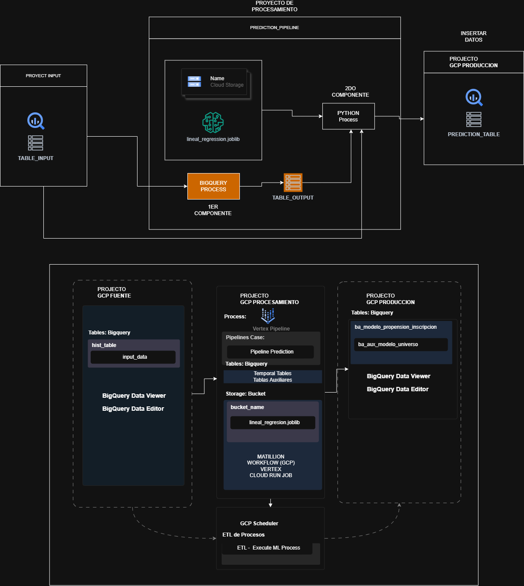

# Pipeline de Predicción en GCP – Proyecto Final MLOps17

Pipeline automatizado que lee datos desde BigQuery, los prepara con SQL, ejecuta un modelo de regresión lineal almacenado en Cloud Storage y guarda el histórico de predicciones en BigQuery de un proyecto de producción. Se ejecuta en **Vertex AI Pipelines** con una **cuenta de servicio personalizada**, lanzado por un **Cloud Run Job** y programado con **Cloud Scheduler**.

## 1. Arquitectura



La solución usa tres proyectos de GCP, cada uno con una responsabilidad:

| Proyecto | Rol | Recursos |
|---|---|---|
| `mlops17-fuente` | **Fuente** | BigQuery: `hist_table.input_data` (registros de entrada) |
| `mlops17-507600` | **Procesamiento** | Vertex AI Pipeline · Cloud Storage `mlops17_vertex02` (modelo `linear_regression.joblib`) · BigQuery `tmp_procesamiento` (tablas temporales) · Cloud Run Job · Cloud Scheduler · Artifact Registry |
| `mlops17-produccion` | **Producción** | BigQuery: `modelo_propension.ba_modelo_propension_inscripcion` (histórico de predicciones) |

```
 Cloud Scheduler (etl-execute-ml-process, 06:00 America/Bogota)
        │  POST run.googleapis.com ...:run
        ▼
 Cloud Run Job (run-pipeline-prediction)
        │  aiplatform.PipelineJob.submit(service_account=mlops17-vertex-process)
        ▼
 Vertex AI Pipeline (pipeline-prediction-propension)  ── proyecto de procesamiento
   ├─ Validate Data ............ valida existencia y acceso a tablas, dataset y modelo
   ├─ Componente 1 (BigQuery SQL)
   │     mlops17-fuente.hist_table.input_data  ──►  mlops17-507600.tmp_procesamiento.table_output
   ├─ Componente 2 (Python)
   │     table_output + gs://mlops17_vertex02/proyecto_final/model/linear_regression.joblib
   │     ──►  mlops17-produccion.modelo_propension.ba_modelo_propension_inscripcion (append)
   └─ Notification Email
```

Todos los datasets de BigQuery están en la multirregión **US**; los servicios de cómputo en **us-central1**.

## 2. Pipeline de predicción

**Validate Data** – con la cuenta de servicio del pipeline comprueba que:
- la tabla fuente exista, tenga filas y se pueda leer;
- la tabla de features exista y se pueda leer;
- el dataset de producción exista y sea accesible;
- el modelo exista en Cloud Storage.

Si algo falla, el pipeline toma la rama `no-execute` y termina con error indicando qué recurso falló.

**Componente 1 – Extracción y procesamiento (BigQuery SQL).** Lee `input_data` del proyecto fuente, selecciona las 36 variables del modelo (`tmp_procesamiento.selected_features`), reemplaza nulos, castea a `FLOAT64`, agrega `id_registro` y genera la tabla temporal **TABLE_OUTPUT** (`tmp_procesamiento.table_output`).

**Componente 2 – Predicción (Python).** Lee TABLE_OUTPUT, carga `linear_regression.joblib` desde Cloud Storage, ejecuta la predicción y agrega (`WRITE_APPEND`) los resultados en la tabla de producción con campos de auditoría:

| Campo | Tipo | Descripción |
|---|---|---|
| `id_registro` | INT64 | Registro de entrada |
| `prediction` | FLOAT64 | Predicción del modelo (log del precio de venta) |
| `creation_user` | STRING | Identidad que ejecutó el proceso (la cuenta de servicio) |
| `process_date` | DATE | Fecha de proceso |
| `load_date` | DATETIME | Fecha y hora de carga |

Librerías: `pandas`, `scikit-learn`, `joblib`, `google-cloud-bigquery`, `google-cloud-storage`, `kfp`.

El modelo es una regresión lineal regularizada (Lasso, `sklearn.linear_model`) entrenada en el curso sobre el dataset House Prices; se guardó con el nombre pedido en el enunciado, `linear_regression.joblib`.

## 3. Configuración de permisos

Todo el proceso se ejecuta con la cuenta de servicio personalizada
**`mlops17-vertex-process@mlops17-507600.iam.gserviceaccount.com`**. Un proyecto no recibe permisos por sí mismo: se otorgan a la identidad que ejecuta el proceso. Siguiendo el principio de mínimo privilegio, los permisos sobre datos se dieron a nivel de tabla, dataset o bucket, no de proyecto.

### Permisos entre proyectos

| Acceso | Recurso | Rol | Por qué es necesario |
|---|---|---|---|
| Leer datos del proyecto fuente | Tabla `mlops17-fuente.hist_table.input_data` | **BigQuery Data Viewer** | El Componente 1 lee los registros de entrada desde otro proyecto. Sin este rol la consulta falla con *Access Denied*. Solo permite leer: no puede modificar ni borrar datos de la fuente. |
| Escribir resultados en producción | Dataset `mlops17-produccion.modelo_propension` | **BigQuery Data Editor** | El Componente 2 crea la tabla de predicciones en la primera ejecución y agrega filas en cada corrida. Se da sobre el dataset porque la tabla aún no existe al otorgar el permiso. |
| Leer el modelo | Bucket `mlops17_vertex02` | **Storage Object Viewer** | El Componente 2 descarga `linear_regression.joblib` para predecir. El objeto no es público. |

### Permisos dentro del proyecto de procesamiento

| Rol | Recurso | Por qué es necesario |
|---|---|---|
| BigQuery Data Editor | Dataset `tmp_procesamiento` | El Componente 1 crea/reemplaza TABLE_OUTPUT y lee `selected_features`. |
| Storage Object Creator | Bucket `mlops17_vertex02` | Vertex escribe los artefactos de ejecución en `pipeline_root`. |
| BigQuery Job User | Proyecto | Las consultas y cargas se ejecutan como *jobs* en el proyecto de procesamiento (que es el que paga). |
| BigQuery Read Session User | Proyecto | Lectura eficiente de tablas a DataFrame (BigQuery Storage API). |
| Vertex AI User (Agent Platform) | Proyecto | Crear y ejecutar el PipelineJob. |
| Service Account User | Sobre la propia SA | El Cloud Run Job (que corre como la SA) lanza el pipeline indicando esa misma SA. |
| Cloud Run Invoker | Proyecto | Cloud Scheduler se autentica como la SA para ejecutar el Cloud Run Job. |
| Artifact Registry Reader | Proyecto | Leer imágenes de contenedores. |
| Logs Writer / Monitoring Metric Writer | Proyecto | Registrar logs y métricas de los componentes. |

## 4. Estructura del repositorio

```
├── pipeline/
│   ├── pipeline_prediction_proyecto_final.ipynb   # componentes, pipeline, compilación y ejecución
│   └── requirements.txt
├── cloud_run_job/
│   ├── main.py            # lanza el PipelineJob con la SA personalizada
│   ├── Dockerfile
│   └── requirements.txt
└── evidencias/            # capturas de configuración y ejecución
```

## 5. Despliegue

Ejecutado desde Cloud Shell, proyecto `mlops17-507600`.

1. **Compilar y ejecutar el pipeline**: ejecutar `pipeline/pipeline_prediction_proyecto_final.ipynb`. Compila `pipeline_prediction.json`, lo sube a `gs://mlops17_vertex02/proyecto_final/` y lanza una ejecución con la SA.

2. **Cloud Run Job**
   ```bash
   P=mlops17-507600
   SA=mlops17-vertex-process@$P.iam.gserviceaccount.com
   IMG=us-central1-docker.pkg.dev/$P/ml-repo/pipeline-runner

   gcloud iam service-accounts add-iam-policy-binding $SA \
     --member=serviceAccount:$SA --role=roles/iam.serviceAccountUser

   cd cloud_run_job
   gcloud builds submit --tag $IMG
   gcloud run jobs create run-pipeline-prediction --image $IMG --region us-central1 \
     --service-account $SA --set-env-vars "PROJECT_ID=$P,LOCATION=us-central1,SERVICE_ACCOUNT=$SA,PIPELINE_PATH=gs://mlops17_vertex02/proyecto_final/pipeline_prediction.json,SOURCE_TABLE=mlops17-fuente.hist_table.input_data,FEATURES_TABLE=$P.tmp_procesamiento.selected_features,TABLE_OUTPUT=$P.tmp_procesamiento.table_output,PREDICTION_TABLE=mlops17-produccion.modelo_propension.ba_modelo_propension_inscripcion,MODEL_PATH=gs://mlops17_vertex02/proyecto_final/model/linear_regression.joblib"
   ```

3. **Cloud Scheduler**
   ```bash
   gcloud projects add-iam-policy-binding $P \
     --member=serviceAccount:$SA --role=roles/run.invoker --condition=None

   gcloud scheduler jobs create http etl-execute-ml-process --location us-central1 \
     --schedule "0 6 * * *" --time-zone "America/Bogota" --http-method POST \
     --uri "https://run.googleapis.com/v2/projects/$P/locations/us-central1/jobs/run-pipeline-prediction:run" \
     --oauth-service-account-email $SA
   ```

## 6. Evidencias

| # | Evidencia |
|---|---|
| 01 | [Proyecto fuente: SA con BigQuery Data Viewer sobre `input_data`](evidencias/01_fuente_permisos.png) |
| 02 | [Proyecto producción: SA con BigQuery Data Editor sobre `modelo_propension`](evidencias/02_produccion_dataset_permisos.png) |
| 03 | [Procesamiento: SA con BigQuery Data Editor sobre `tmp_procesamiento`](evidencias/03_procesamiento_tmp_dataset_permisos.png) |
| 04 | [Modelo `linear_regression.joblib` en Cloud Storage](evidencias/04_procesamiento_bucket_modelo.png) |
| 05 | [Bucket: SA con Storage Object Viewer](evidencias/05_procesamiento_bucket_permisos.png) |
| 06 | [Pipeline en Vertex AI ejecutado con la cuenta de servicio personalizada](evidencias/06_vertex_pipeline_sa.png) |
| 07 | [Tabla final `ba_modelo_propension_inscripcion` con predicciones](evidencias/07_produccion_tabla_predicciones.png) |
| 08 | [Ejecución del Cloud Run Job](evidencias/08_cloud_run_job_ejecucion.png) |
| 09 | [Configuración del Cloud Run Job (imagen y SA)](evidencias/09_cloud_run_job_config.png) |
| 10 | [Cloud Scheduler](evidencias/10_cloud_scheduler.png) |
| 11 | [Roles IAM de la SA en el proyecto de procesamiento](evidencias/11_iam_sa_procesamiento.png) |
